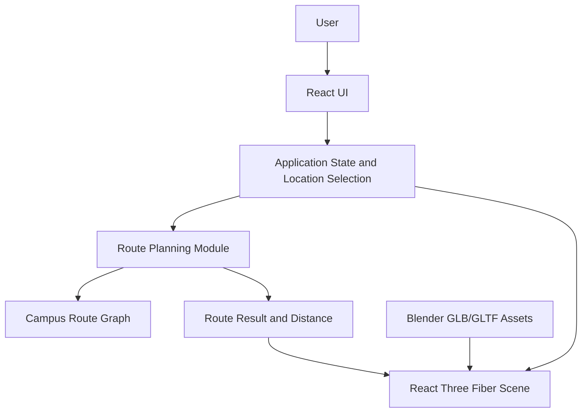
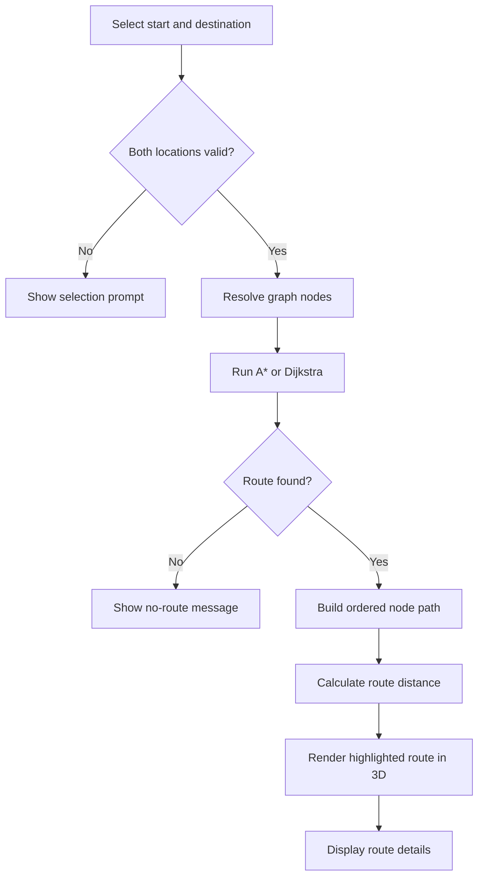

> # Architecture diagrams

> ## High-level architecture

> ## Route-planning flow

> ## Suggested component responsibilities

| Component/module | Responsibility |
|---|---|
| `CampusScene` | Loads and displays the campus model and scene lighting |
| `LocationSelector` | Lets the user choose start and destination |
| `LocationData` | Stores location IDs, labels, and corresponding graph-node IDs |
| `RouteGraph` | Stores nodes, edges, and edge costs |
| `Pathfinding` | Implements A* or Dijkstra and returns an ordered node path |
| `RouteRenderer` | Converts the route path into 3D coordinates and displays it |
| `RouteSummary` | Shows distance and estimated travel time, if configured |

These names are suggestions, not requirements; the actual source structure can differ.

> ## Data flow
The user chooses a start and destination.
The application resolves both locations to graph nodes.
The pathfinding module searches the graph.
The result is an ordered sequence of graph nodes or an indication that no path exists.
The application converts the sequence to 3D coordinates.
The 3D scene highlights the route and the interface shows route details.

> ## Architecture decisions
The route graph is separate from the visible 3D model; visual geometry alone is not sufficient for reliable pathfinding.
The initial prototype does not map real-world GPS coordinates to the virtual map.
A client-side implementation is sufficient for the initial scope.
Route distance should be derived from graph edge weights rather than guessed from the visual line.
